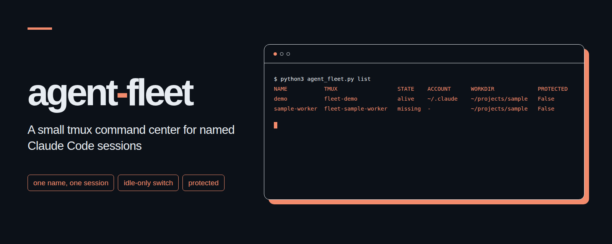

# agent-fleet
<p align="center"></p>

터미널 하나에서 이름 붙인 여러 Claude Code 세션을 실행하고 관리하는 작은 tmux 도구입니다.

[English](README.md)

## 왜 쓰나요

작업마다 이름을 붙여 실행하고, 어떤 세션이 살아 있는지 확인하며, 멈춘 장기 작업을 다시 띄웁니다. Claude 세션이 입력을 기다릴 때는 두 세션을 동시에 열지 않고도 같은 대화를 다른 계정 폴더로 옮겨 이어갈 수 있습니다. 건드리면 안 되는 세션에는 보호 표시를 걸어 둡니다.

## 설치 3단계

1. Linux 또는 macOS에 Python 3.11 이상, tmux, 최신 버전의 Claude Code를 설치합니다. 파이썬 외부 패키지는 필요하지 않으며 표준 라이브러리만 사용합니다. 도구 버전을 확인합니다.

   ```sh
   python3 --version
   tmux -V
   claude --version
   ```

2. 명령줄 도구를 모아 두는 위치에 이 폴더를 둡니다. 사용할 각 계정 폴더에서 미리 Claude Code 로그인을 마쳐 두세요. `--account`나 `switch`를 쓰려면 계정 폴더가 이미 준비되어 있어야 합니다. agent-fleet가 계정을 만들거나 대신 로그인해 주지는 않습니다.

3. 이 폴더에서 실행 구성을 미리 확인합니다.

   ```sh
   python3 agent_fleet.py spawn demo . examples/brief.md --dry-run
   ```

   실제로 띄우려면 `--dry-run`을 빼고 실행합니다. 폴더 신뢰 확인 창이 뜨면 직접 검토할 수 있도록 화면에 그대로 남습니다. `list`로 tmux 세션을 찾은 뒤 `tmux attach -t <tmux-session>`으로 접속합니다.

## 명령어

모든 명령어는 앞에 `python3 agent_fleet.py`를 붙여 실행합니다.

이름은 영문자로 시작해야 하며 영문자, 숫자, `_`, `-`만 사용해 최대 64자까지 지을 수 있습니다. `--account`를 생략하면 `CLAUDE_CONFIG_DIR`에 지정된 계정 폴더를 쓰고, 그 값도 없으면 `~/.claude`를 기본값으로 씁니다.

| 명령어 | 하는 일 |
| --- | --- |
| `spawn <name> <workdir> <brief.md>` | 지시서 파일을 첫 프롬프트로 삼아 이름 붙인 Claude 세션을 시작합니다. |
| `spawn ... --account DIR` | 이미 있는 폴더를 `CLAUDE_CONFIG_DIR`로 지정합니다. |
| `spawn ... --model M --effort E --permission-mode P` | Claude 옵션을 직접 지정합니다. 권한 방식의 기본값은 `default`입니다. |
| `spawn ... --dry-run` | tmux를 띄우거나 상태 장부를 기록하지 않고 실행 내용만 미리 보여 줍니다. |
| `list [--json]` | 상태 장부 기록과 실제 tmux 세션 유무, 계정 폴더, 작업 폴더를 보여 줍니다. |
| `switch <name> <account-dir> [--wait MIN]` | 안전한 입력 대기 상태가 될 때까지 최대 MIN분 동안 기다린 뒤, 같은 대화를 다른 기존 계정 폴더에서 이어 엽니다. 기본값은 대기 없음입니다. |
| `protect <name>` | 해당 세션의 계정 전환을 막습니다. |
| `unprotect <name>` | 보호 설정을 해제합니다. |
| `keep [--config fleet.toml]` | 설정된 명령어 중 tmux 세션이 없는 항목을 다시 띄웁니다. |

사용 예:

```sh
python3 agent_fleet.py spawn demo . examples/brief.md --model sonnet --effort high
python3 agent_fleet.py list
python3 agent_fleet.py protect demo
python3 agent_fleet.py unprotect demo
python3 agent_fleet.py switch demo "$HOME/.claude-alternate" --wait 2
```

## 안전장치

- 상태 장부에 잠금을 걸어 같은 이름의 활성 세션이 중복으로 열리는 것을 막습니다. 장부를 갱신할 때는 새 파일을 먼저 완성한 뒤 기존 파일을 원자적으로 교체합니다.
- 대화마다 잠금을 걸어 같은 대화가 동시에 두 번 전환되는 일을 막습니다.
- 계정을 전환하려면 Claude의 `Notification` 훅에서 온 `idle_prompt` 알림, 비어 있는 터미널 입력창, 실행 중인 도구나 서브에이전트가 없음, 실행 중인 자식 프로세스가 없음을 모두 확인해야 합니다. 상태를 알 수 없으면 작업 중인 것으로 간주합니다.
- `Stop` 훅에서 세션 백그라운드 작업이나 예약된 깨우기 작업이 보고되면 전환하지 않습니다. tmux에 클라이언트가 접속해 있어도 전환을 거부하므로 먼저 접속을 해제해야 합니다.
- 입력 대기 알림은 응답이 끝난 뒤 추가 입력이 없을 때 보통 약 60초 후에 도착합니다. 화면에 입력창이 보이는 것만으로는 충분하지 않으며, `--wait 2` 옵션을 주면 알림이 올 때까지 기다릴 수 있습니다.
- 폴더 신뢰 확인 창은 자동으로 승인하지 않습니다. 권한 요청 창이 떠 있는 상태도 입력 대기로 보지 않습니다.
- 기존 Claude 프로세스가 완전히 종료된 것을 확인한 뒤에야 새 계정에서 프로세스를 시작합니다. 실행 중인 tmux 창을 강제로 갈아 끼우지 않습니다.
- 새 계정에서 대화를 이어 열지 못하면 원래 계정으로 복구를 시도합니다. 이때도 실패한 새 프로세스가 멈췄음을 먼저 확인해야 하며, 종료가 확인되지 않으면 추가 실행을 막습니다.
- 대화 파일은 계정 인증 정보와 분리하여 복사합니다. 대상 폴더에 이미 똑같은 대화 기록이 있으면 그대로 재사용합니다. 대상 기록이 비어 있지 않고 원본의 앞부분과 줄 끝까지 정확히 일치하는 이전 기록이라면, `.backup-<id>`로 백업한 뒤 최신 기록으로 갱신합니다. 내용이 서로 갈라진 기록은 거부하며, 함께 저장되는 부가 파일의 내용이 다른 경우에도 거부합니다.
- 보호 설정된 세션은 전환할 수 없습니다. `kill` 명령어는 제공하지 않습니다. 다만 이러한 보호 장치가 tmux나 Claude Code에 직접 내리는 명령어까지 가로채서 막아 주지는 않습니다.

계정을 전환하기 전에는 세션에서 빠져나와야 하며, 명령어가 실행되는 동안에는 세션에 아무것도 입력하지 마세요. 잠금 장치는 같은 컴퓨터에서 실행한 agent-fleet 명령어끼리만 조율합니다. 수동으로 실행한 Claude 프로세스, 다른 컴퓨터의 작업, 다른 프로그램이 파일을 직접 변경하는 것까지는 제어하지 못합니다.

| 종료 코드 | 뜻 |
| --- | --- |
| `0` | 성공. |
| `2` | 잘못된 인자 또는 설정. |
| `3` | 보호된 세션. |
| `4` | 세션을 찾지 못함. |
| `5` | 작업 중, 클라이언트 접속 중, 또는 입력 대기를 확인하지 못함. |
| `6` | 이전 프로세스 또는 실패한 교체 프로세스의 종료를 확인하지 못함. |
| `7` | 폴더 신뢰 확인 창. |
| `8` | spawn의 최초 실행 확인 실패, 또는 이어 열기 실패 후 원래 계정으로 복구를 시도함. |
| `9` | 이름 중복 또는 상태 장부 충돌. |

## 상태 저장과 장기 작업

상태 폴더 위치는 `AGENT_FLEET_DIR`로 지정하며 기본값은 `~/.local/state/agent-fleet`입니다. 이곳에 `ledger.json`, 잠금 파일, 실행별 파일을 둡니다. 계정 경로, 작업 폴더, 대화 식별자가 기록되므로 이 폴더는 비공개로 보관하고 공개 저장소에 올리지 마세요.

`keep`은 상태를 한 번 점검하고 끝나는 명령어로, cron에 등록해 쓰기 적합합니다. 설정된 tmux 세션이 없을 때만 명령어를 다시 실행하며, 이미 살아 있는 세션 안의 작업이 정상 작동 중인지까지는 판단하지 않습니다. 다시 시작해도 안전한 명령어들을 [examples/fleet.toml](examples/fleet.toml) 구조에 맞춰 작성해 두세요. 각 `[[jobs]]` 항목에는 `name`과 `command`를 넣습니다. 명령어가 문자열이면 `/bin/sh`를 통해 실행하고, 배열이면 적힌 인자를 직접 실행합니다. 선택 항목인 `workdir`의 상대 경로는 설정 파일 기준이며, 생략하면 설정 파일이 있는 폴더를 씁니다. 관리 중인 Claude 세션의 이름은 작업 이름으로 다시 쓸 수 없습니다. 다시 실행한 내역은 화면에 출력되고 상태 폴더의 `keep.log`에 한 줄씩 추가됩니다.

이 폴더가 `$HOME/tools/agent-fleet`에 있을 때 10분마다 확인하는 cron 설정 예:

```cron
*/10 * * * * cd "$HOME/tools/agent-fleet" && python3 agent_fleet.py keep --config examples/fleet.toml
```

`AGENT_FLEET_TMUX_SOCKET`으로 별도 tmux 소켓을 지정할 수 있습니다. `tmux -L NAME`과 같으며, 직접 접속하는 명령어를 포함해 같은 세션들을 관리하는 모든 명령어에 동일한 값을 써야 합니다. `AGENT_FLEET_START_TIMEOUT`과 `AGENT_FLEET_STOP_TIMEOUT`은 시작 확인과 종료 확인의 제한 시간을 초 단위로 정하며, 기본값은 각각 75초와 20초입니다.

## 터미널 출력 예

아래 경로, 이름, 식별자는 모두 예시용 가짜 값입니다.

```text
$ python3 agent_fleet.py list
NAME           TMUX                  STATE    ACCOUNT      WORKDIR             PROTECTED
demo           fleet-demo            alive    ~/.claude    ~/projects/sample   False
sample-worker  fleet-sample-worker   missing  -            ~/projects/sample   False
```

## 테스트

```sh
python3 -m unittest -v
```

테스트를 실행하면 별도 소켓에 실제 tmux 세션을 띄우고, PATH에 가짜 `claude` 실행 파일을 넣어 동작을 검증합니다. 실제 Claude 서버와 통신하거나 진짜 계정을 쓰지는 않습니다. 환경에 tmux가 없으면 tmux가 필요한 테스트는 건너뛴 것으로 표시합니다.

## 공식 문서 확인

**2026-11-02**에 Anthropic의 최신 Claude Code 공식 문서를 기준으로 확인했습니다.

| 공식 문서 | 확인한 내용 |
| --- | --- |
| [명령줄 안내](https://code.claude.com/docs/en/cli-reference) | 첫 지시문, `--resume`, `--session-id`, `--name`, `--model`, `--effort`, `--permission-mode`, `--settings`. |
| [설정](https://code.claude.com/docs/en/settings) | `--settings`로 세션 설정을 전달하는 방법. |
| [환경 변수](https://code.claude.com/docs/en/env-vars) | `CLAUDE_CONFIG_DIR`로 계정 저장 폴더를 지정하는 방법. |
| [이벤트 알림](https://code.claude.com/docs/en/hooks) | 세션 및 도구 이벤트, `session_id`, `transcript_path`, `idle_prompt`가 오는 시점. |
| [대화 관리](https://code.claude.com/docs/en/sessions) | 대화 ID로 이어 열기와 로컬 대화 파일 위치. |
| [권한 방식](https://code.claude.com/docs/en/permission-modes) | Claude에 전달하는 권한 방식의 뜻. |

공식 문서에 없는 Claude 명령줄 옵션은 쓰지 않습니다. 계정 폴더 사이의 대화 복사는 이 도구가 수행하는 로컬 작업이며, Anthropic이 제공하는 계정 이전 API는 아닙니다. 대화 파일 위치는 문서에 나와 있지만 JSONL 레코드 형식과 함께 저장되는 부가 파일은 내부 세부 사항이므로 바뀔 수 있습니다. agent-fleet는 레코드 내용을 해석하지 않고 대화 파일을 그대로 복사하며, 이어 열린 대화의 ID를 이벤트 훅으로 확인합니다. 로그인 인증 정보, 계정 설정, 파일 체크포인트, 실행 때 정한 권한 방식 밖의 허용 내역, 세션 타이머, 실행 중인 작업은 옮기지 않습니다. Claude Code를 업그레이드한 뒤에는 호환성을 확인하세요.

## 라이선스

[MIT](LICENSE), Copyright (c) 2026 kks0488.
