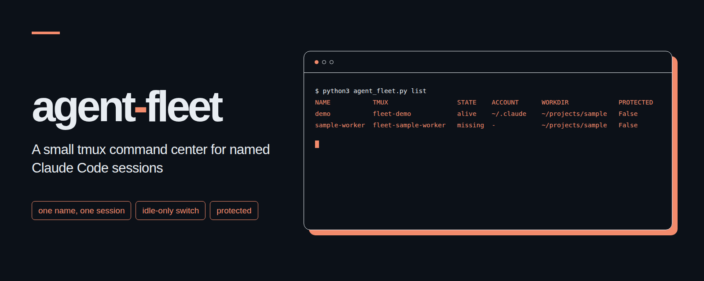

# agent-fleet
<p align="center"></p>

A small tmux command center for running several named Claude Code sessions from one terminal.

[한국어](README.ko.md)

## Why

Give each task a name, see which sessions still exist, and restart missing long-running commands. When a Claude session is waiting for input, move the same conversation to another account directory without opening two copies at once. Mark sessions that must stay untouched as protected.

## Install in three steps

1. Install Python 3.11 or newer, tmux, and a current Claude Code release on Linux or macOS. Python dependencies are all in the standard library. Check the tools:

   ```sh
   python3 --version
   tmux -V
   claude --version
   ```

2. Put this directory wherever you keep command-line tools. Sign in to Claude Code separately in each account directory you intend to use. Existing account directories must be available before using `--account` or `switch`; agent-fleet does not create accounts or sign in for you.

3. Open this directory and preview a launch:

   ```sh
   python3 agent_fleet.py spawn demo . examples/brief.md --dry-run
   ```

   Remove `--dry-run` to launch. Any folder trust dialog remains on screen for you to review. Use `list` to find the tmux session and `tmux attach -t <tmux-session>` to open it.

## Commands

Run each command as `python3 agent_fleet.py <command>`.

Names start with a letter, use letters, digits, `_` or `-`, and have at most 64 characters. Without `--account`, the account directory comes from `CLAUDE_CONFIG_DIR` or defaults to `~/.claude`.

| Command | Purpose |
| --- | --- |
| `spawn <name> <workdir> <brief.md>` | Start a named Claude session with the brief as its initial prompt. |
| `spawn ... --account DIR` | Use that existing directory as `CLAUDE_CONFIG_DIR`. |
| `spawn ... --model M --effort E --permission-mode P` | Choose Claude options explicitly. Permission mode defaults to `default`. |
| `spawn ... --dry-run` | Preview the launch without starting tmux or writing state. |
| `list [--json]` | Show ledger entries, actual tmux presence, account directories, and working directories. |
| `switch <name> <account-dir> [--wait MIN]` | Wait up to MIN minutes for a safe input prompt, then resume the same conversation in another existing account directory. The default is no wait. |
| `protect <name>` | Prevent managed account switching for this session. |
| `unprotect <name>` | Remove that protection. |
| `keep [--config fleet.toml]` | Start configured commands whose tmux sessions are missing. |

For example:

```sh
python3 agent_fleet.py spawn demo . examples/brief.md --model sonnet --effort high
python3 agent_fleet.py list
python3 agent_fleet.py protect demo
python3 agent_fleet.py unprotect demo
python3 agent_fleet.py switch demo "$HOME/.claude-alternate" --wait 2
```

## Safety checks

- A locked ledger rejects a second live session with the same name. Ledger updates replace the old file atomically.
- A conversation lock prevents two managed switches from acting on the same conversation at once.
- Switching requires Claude's `Notification` hook with `idle_prompt`, an empty terminal prompt, no active tools or subagents, and no child processes. Unknown state is treated as busy.
- Session background tasks and scheduled wakeups reported by the `Stop` hook prevent switching. An attached tmux client also prevents switching; detach first.
- The idle notification usually arrives about 60 seconds after a reply, if you have not typed since. A visible prompt alone is insufficient. `--wait 2` allows time for the notification.
- A folder trust dialog is never approved automatically. A permission request is not treated as idle.
- The original Claude process must exit before its replacement starts. There is no forced tmux pane replacement.
- If the new account cannot resume, agent-fleet attempts to restore the original account. It must confirm that the failed replacement has stopped before doing so. A failure to prove shutdown prevents another launch.
- Conversation files are copied separately from account credentials. Identical destination history is reused. A nonempty destination transcript that matches the start of the source exactly and ends at a complete line is backed up as `.backup-<id>` before being refreshed. Divergent history is refused. Existing sidecar files with different contents are also refused.
- Protected sessions cannot be switched. There is no `kill` command. These protections do not intercept commands issued directly to tmux or Claude Code.

Detach from the session before switching, and avoid typing into it while the command is running. Locks coordinate agent-fleet commands on this machine; they cannot coordinate manually started Claude processes, other machines, or changes to the files by other programs.

| Exit code | Meaning |
| --- | --- |
| `0` | Success. |
| `2` | Invalid arguments or configuration. |
| `3` | Protected session. |
| `4` | Missing session. |
| `5` | Busy, attached, or unverified input prompt. |
| `6` | A previous or failed replacement process could not be confirmed stopped. |
| `7` | Folder trust dialog. |
| `8` | Initial spawn verification failed, or resume failed and original-account recovery was attempted. |
| `9` | Duplicate name or ledger conflict. |

## State and long-running commands

`AGENT_FLEET_DIR` selects the state directory, defaulting to `~/.local/state/agent-fleet`. It contains `ledger.json`, locks, and per-launch files. Keep this directory private: it records account paths, working directories, and conversation identifiers. It is runtime data and does not belong in a public repository.

`keep` is a single check, suitable for cron. It restarts a configured command only when its tmux session is missing; it does not decide whether a command inside an existing session is healthy. Use the structure in [examples/fleet.toml](examples/fleet.toml), with commands that can safely restart. Each `[[jobs]]` table has a `name` and `command`. A string command runs through `/bin/sh`; an array runs its arguments directly. Optional `workdir` is relative to the config file, defaulting to its directory. A job cannot reuse the name of a managed Claude session. Restarts are printed and appended to `keep.log` in the state directory.

Example cron entry, assuming this directory is at `$HOME/tools/agent-fleet`:

```cron
*/10 * * * * cd "$HOME/tools/agent-fleet" && python3 agent_fleet.py keep --config examples/fleet.toml
```

`AGENT_FLEET_TMUX_SOCKET` selects a separate tmux socket, equivalent to `tmux -L NAME`. Use the same value for all commands managing that fleet, including manual attaches. `AGENT_FLEET_START_TIMEOUT` and `AGENT_FLEET_STOP_TIMEOUT` set the launch and shutdown verification timeouts in seconds, defaulting to 75 and 20 respectively.

## Example terminal output

The paths, names, and identifiers below are fictional:

```text
$ python3 agent_fleet.py list
NAME           TMUX                  STATE    ACCOUNT      WORKDIR             PROTECTED
demo           fleet-demo            alive    ~/.claude    ~/projects/sample   False
sample-worker  fleet-sample-worker   missing  -            ~/projects/sample   False
```

## Tests

```sh
python3 -m unittest -v
```

The tests start real tmux sessions on a separate socket and put a fake `claude` executable on PATH. They do not contact Claude or use a real account. Tests requiring tmux are reported as skipped when tmux is unavailable.

## Official documentation

Checked on **2026-11-02** against Anthropic's current Claude Code documentation:

| Source | What was checked |
| --- | --- |
| [CLI reference](https://code.claude.com/docs/en/cli-reference) | Initial prompt, `--resume`, `--session-id`, `--name`, `--model`, `--effort`, `--permission-mode`, and `--settings`. |
| [Settings](https://code.claude.com/docs/en/settings) | Session settings supplied through `--settings`. |
| [Environment variables](https://code.claude.com/docs/en/env-vars) | Account storage selection with `CLAUDE_CONFIG_DIR`. |
| [Hooks](https://code.claude.com/docs/en/hooks) | Session and tool events, `session_id`, `transcript_path`, and the timing of `idle_prompt`. |
| [Sessions](https://code.claude.com/docs/en/sessions) | Resuming by conversation ID and the location of local transcripts. |
| [Permission modes](https://code.claude.com/docs/en/permission-modes) | The meaning of the permission mode passed to Claude. |

No undocumented Claude command-line flags are used. Copying a conversation between account directories is a local procedure implemented here, not an Anthropic account-transfer API. Transcript locations are documented, but the JSONL record format and associated sidecar files are internal details that may change. agent-fleet copies conversation files without parsing their records and checks the resumed ID through hooks. It does not transfer credentials, account settings, file checkpoints, permissions outside the selected launch mode, session timers, or running tasks. Review compatibility after upgrading Claude Code.

## License

[MIT](LICENSE), Copyright (c) 2026 kks0488.
